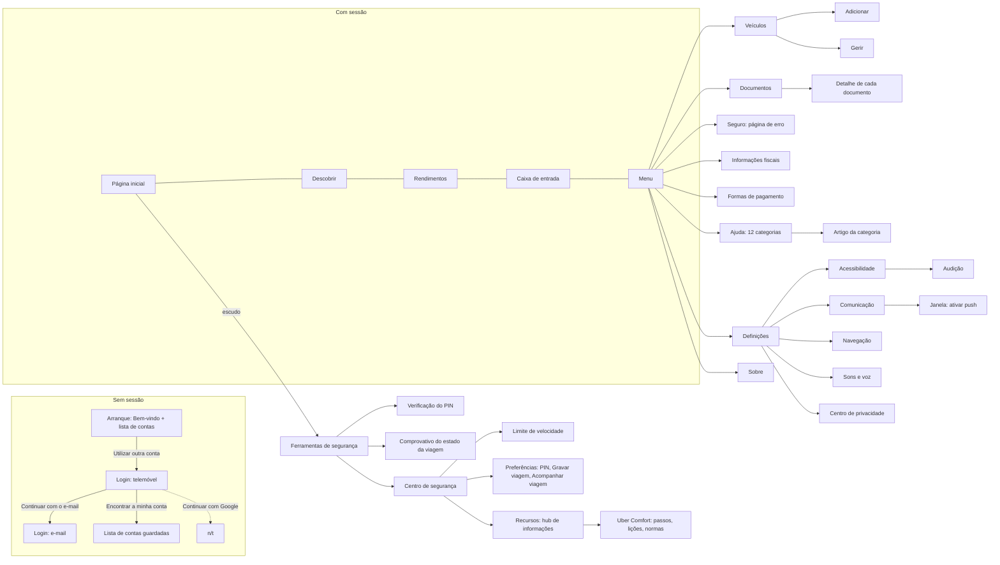

# ux_behavior.md — comportamento da Uber Driver (original)

Spec de comportamento da FASE 0.5 (§5 do `PROMPT_SPEC_UIUX.md`). Descreve **como a app se comporta**, e não só o que mostra. Cada afirmação traz a sua evidência.

**Convenção:** `[obs]` observado nas capturas, nos vídeos ou nas árvores de views. `[inf]` inferido, com motivo. `[n/t]` não testado.

**Versões:** a captura 000 a 030 é da **4.600.10000** (a referência do APK extraído). A 031 em diante e os vídeos são da **4.601.10000**, porque a app se atualizou sozinha às 20:49 de 16-10. Registo por ficheiro em `versoes.csv`.

**Dados pessoais:** nomes, moradas, matrículas e valores reais não aparecem aqui. Na recriação, o conteúdo vem de fixtures.

**Fontes:** `travessia.csv` (transições), `navegacao_edges.csv` (74 transições normalizadas), `correlacao_layouts.csv` (capturas ↔ layouts), `versoes.csv`, `videos/*.mp4`, `dumps/*.xml`, `../ui_spec/` (animações extraídas).

---

## 1. Mapa de navegação

### 1.1 Estrutura principal

Barra de 5 separadores fixa em baixo `[obs]`: **Página inicial**, **Descobrir**, **Rendimentos**, **Caixa de entrada** (com contador de notificações novas) e **Menu** (com indicador "Nova notificação"). O separador ativo fica a negrito, com ícone preenchido `[obs]`.

`[obs]` Todos os nós a cheio foram abertos e capturados. A tabela completa de transições está em `navegacao_edges.csv`.

### 1.2 Duas apresentações da Página inicial

- **Painel** `[obs]`: barra "Está offline / Está online", botão de ficar online, secções "Oportunidades", "Tendências de rendimentos" e horas de ponta de voos (com scroll vertical).
- **Mapa** `[obs]`: botão redondo "INICIAR" (offline), atalhos (casa, "Uber Pro", pesquisa, escudo, relâmpago, gráfico, localização) e um painel inferior com a alça de arrastar. Não tem a barra de separadores.
- **Como se passa de uma a outra:** `[inf]` o ícone da casa, no canto do mapa, volta ao painel. A app arranca no painel (arranque a frio, 117) e, depois de uma sessão online, ficou no mapa (captura 110). O botão que abre o mapa não foi tocado (ficar online é uma ação da conta).

### 1.3 Onde há saída da app `[obs]`

- "Ver detalhes" e o mapa de tendências em Rendimentos abrem o seletor do Android "Abrir com". O ecrã seguinte não foi capturado.
- Os botões de "Ações necessárias" abrem as Definições do Android (não tocados).

---

## 2. Gestos por elemento

| Elemento | Gesto | Resultado | Evidência |
|---|---|---|---|
| Separadores do fundo | Toque | Muda de página, sem animação visível (ver §3) | `fluxo_separadores.mp4` |
| Páginas com listas | Deslizar na vertical | Revela secções abaixo da dobra (Início 3 viewports, Descobrir 3, Rendimentos 2, Caixa 2, Menu 2, Ajuda 1) | capturas `060` a `065` |
| Definições (lista) | Deslizar | Sem conteúdo abaixo, a lista cabe num ecrã | `066` |
| Cartões de promoções (Descobrir) | Deslizar na horizontal | 5 cartões com indicador de pontos; páginas `080_h0` a `h5` | `080` |
| Faixa dos dias (Descobrir) | Deslizar na horizontal | Mostra mais dias; 2 viewports | `081` |
| Botões "Lembretes / Promoções / Aeroportos" (Descobrir) | Toque | **São filtros**: ficam pretos quando ligados e cinzentos quando desligados. Repostos ao estado inicial | `036`, `039` |
| Mapa (offline) | Deslizar para baixo ou cima | Move o painel inferior ou o mapa | `110_s1..s5` |
| Rendimentos (offline) | Arrastar para atualizar | Sem alteração visível, 1 s e 4 s depois | `116`, `126` |
| Início (offline) | Arrastar para atualizar | Sem alteração visível | `125` |
| Acordeões no Centro de segurança | Toque no cabeçalho | Expande e recolhe os artigos | `017`, `018`, `020` |
| Linhas com seta (›) | Toque | Abre outro ecrã (Definições, Documentos, Comunicação) | `043` a `051` |
| Linhas com interruptor | Toque | `[n/t]` aplicado por segurança, não tocados | `044`, `046`, `047` |
| Botões de escolha (rádio) | Toque | `[n/t]` não tocados | `045`, `021` |
| Pressão longa, deslizar nos itens de lista | — | `[n/t]` | — |

---

## 3. Animações e transições

### 3.1 Medido nos vídeos (4.601.10000)

Método: deteção de mudanças de imagem com `ffmpeg` e agrupamento em rajadas (intervalo < 0,35 s). O `screenrecord` só emite frames quando o ecrã muda, por isso é uma medição por baixo.

| Vídeo | Transição | Rajada | Leitura |
|---|---|---|---|
| `fluxo_separadores` | Menu → Início | 0,80 s, 9 frames | Carrega conteúdo de forma progressiva |
| | Início → Descobrir | 1 frame | Troca instantânea |
| | Descobrir → Rendimentos | 1 frame | Troca instantânea |
| | Rendimentos → Caixa de entrada | 0,24 s, 3 frames | Pequena transição |
| | Caixa de entrada → Menu | 0,03 s, 2 frames | Quase instantânea |
| `fluxo_definicoes_ajuda` | 10 passagens (Menu → Definições, submenus, Voltar, Ajuda) | 0,00 a 0,17 s, 1 a 3 frames | Corte quase instantâneo; sem deslize visível |
| `fluxo_offline_separadores` | Toques nos separadores (offline) | 0,00 s, 1 frame (exceto o primeiro) | Troca instantânea |

Nota: houve mais duas mudanças de 1 frame cerca de 0,4 e 0,8 s depois dos toques em Descobrir e em Rendimentos (conteúdo a carregar), que não são parte da transição.

**Conclusão `[obs]`:** a navegação entre separadores e entre Definições e os seus submenus é praticamente um corte, e não um deslize. Uma animação de 200 a 300 ms daria mais de 10 frames a 60 Hz.

**Limite:** não medi aberturas de janelas (bottom sheets) nem o aparecimento da oferta.

### 3.2 Catálogo extraído (`ui_spec/anim`, `animator`, `interpolator`)

| Pasta | Ficheiros | Com duração | Durações mais comuns (ms) |
|---|---|---|---|
| `anim/` | 119 | 66 | 300 (×11), 200 (×11), 1000 (×8), 400 (×5), 275 (×4), 250 (×4) |
| `animator/` | 48 | 26 | 200 (×6), 300 (×5), 150 (×3), 1000 (×2) |
| `interpolator/` | 18 | — | (só definem a curva) |

Exemplos de nomes: `abc_fade_in/out`, `abc_slide_in/out_top/bottom`, `design_bottom_sheet_slide_in/out`. São recursos do Material e de bibliotecas.

**Limite:** **não está estabelecida a ligação entre cada animação e o ecrã que a usa**. Isso exige ler código, o que o spec desaconselha (regra 3). Na recriação, usar os valores do catálogo só onde a captura mostrar uma transição.

---

## 4. Feedback

| Situação | Mecanismo | Evidência |
|---|---|---|
| Sem rede | Faixa vermelha fixa no topo: "Nenhuma rede detetada. Verifique a sua ligação." com seta | `110`, `120` a `124` |
| Falha ao carregar uma página | Texto na página: "Não foi possível efetuar a ligação — Tente novamente dentro de momentos" (Descobrir); "Sem ligação de rede" (Rendimentos); "A carregar." (Caixa de entrada) | `121`, `122`, `123` |
| Erro numa ação | Janela inferior: ícone de aviso, "Erro", "Lamentamos, mas algo correu mal. Tente novamente mais tarde." e botões "Tentar novamente" e "Cancelar" | `115` |
| Erro no arranque a frio | "Está offline", "Ocorreu um erro" e "Tente novamente" | `117` |
| Permissão em falta | Janela inferior "Ativar as notificações push" com "Atualizar definições" e "Cancelar" | `051` |
| Ações bloqueantes | Lista "Ações necessárias (2)" com botões que levam às Definições do Android | `035` |
| Página indisponível | Mensagem "Pedimos desculpa, mas não foi possível encontrar a página" e botão "Exit" (Seguro) | `072` |
| Resultado vazio | "Sem informações a apresentar de momento" (Rendimentos, sessões recentes) | `011` |
| Confirmação antes de ações destrutivas, undo, toasts, haptics | `[n/t]`. Não vi nenhum snackbar nem toast | — |

---

## 5. Botão Voltar

| Contexto | Comportamento `[obs]` |
|---|---|
| Submenus de Definições, Ajuda, Documentos, Veículos | Volta ao ecrã anterior, sem confirmação |
| Comunicação com o botão "Guardar alterações" ativo | Sai sem diálogo de "descartar alterações" |
| Janelas inferiores e o seletor "Abrir com" | Fecham sem escolher nada |
| Gestor de palavras-passe da Google (no login) | Fecha a janela e fica no formulário |
| Campo de texto com foco (login por e-mail) | Um Voltar só retira o foco; a seta da própria página é que volta ao ecrã anterior |
| Raiz (Menu ou outro separador) | **Sai da app** para o ecrã inicial do Android, sem confirmação |

---

## 6. Formulários e controlos

- **Login por telemóvel** `[obs]` (`032`): seletor de país (bandeira e seta) e campo com prefixo "+351"; botão "Continuar"; alternativas "Continuar com Google", "Continuar com o e-mail" e "Encontrar a minha conta"; texto legal com reCAPTCHA. O botão "Continuar" aparece preto, mesmo com o campo vazio.
- **Login por e-mail** `[obs]` (`033`): campo com marcador "nome@exemplo.com", botão "Seguinte" com seta, e botão circular de voltar. Ao focar o campo aparece o gestor de palavras-passe do sistema.
- **Teclado** `[obs]`: o campo de telemóvel abre o teclado numérico, com uma tira de sugestões do sistema.
- **Validação** `[n/t]`: não escrevi em nenhum campo.
- **Preferências de contacto** `[obs]` (`045`): botões de escolha. "Guardar alterações" está desativado (cinzento) ao abrir e ficou ativo depois de abrir e fechar a janela das push, sem nenhuma escolha minha. Não vi a regra que o ativa.
- **Verificação do PIN** `[obs]` (`021`): três opções (todas as viagens, próxima sessão, nenhuma) e botão "Guardar".
- **Navegação** `[obs]` (`046`): escolha única com visto (Uber, Google Maps, Waze) e um interruptor de navegação automática.
- **Sons e voz** `[obs]` (`047`): controlo de volume, botões "Teste", interruptores.
- **Documentos** `[obs]` (`071`): cada documento mostra o estado ("Concluído" ou pendente) e abre a página de detalhe.

---

## 7. Estados online `[obs]` (`100_online_*`)

- Barra "Está online" no painel inicial, com "Radar de viagens" no mapa.
- **Cartão de oferta** que surge sobre o mapa: produto (UberX, Exclusivo, Correspondência), preço "após dedução de taxa de serviço", tempo e distância até à recolha, morada de recolha, duração e distância da viagem, morada de destino. Em algumas capturas há o botão "Aceitar". Nas outras, a árvore não o mostra (cartão em transição, `[inf]`).
- **Frequência:** apareceram 4 ofertas distintas (distinguidas pelo preço) em cerca de 80 s, das 21:50:21 às 21:51:39 de 16-10. Uma delas ficou visível em duas capturas seguidas (5 s de diferença). Ficam 13 capturas `100_online_*`, por causa da sobreposição de dois ciclos de captura (alguns nomes podem ter sido sobrescritos).
- **Duração do cartão e o que acontece quando expira:** `[n/t]`.

---

## 8. Não observado (lacunas que a recriação precisará)

- Aceitar, recusar e o ciclo da viagem (a caminho, chegou, PIN, iniciar, terminar, avaliar, ganhos da viagem).
- Contagem decrescente da oferta, som e vibração da oferta.
- Confirmações de ações destrutivas, "undo", toasts, haptics.
- Validação de formulários, máscaras, comportamento do teclado depois de escrever.
- Pressão longa e deslizar em itens de lista.
- Animações de abrir e fechar janelas e do aparecimento da oferta.
- Estado "Sessão expirada".
- Modo escuro.
- Ecrãs do 3.º nível das Definições e dos artigos de Ajuda.

Estes pontos ficam para a via do laboratório (nosso backend) ou para uma nova captura.
